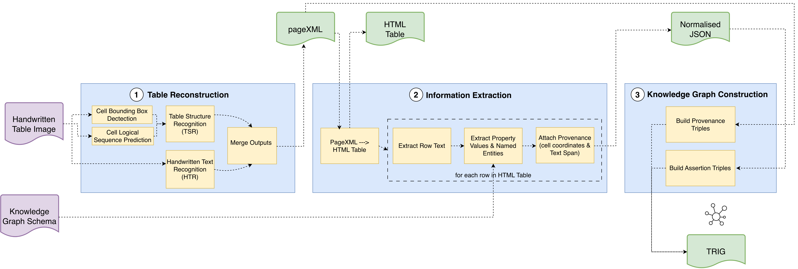
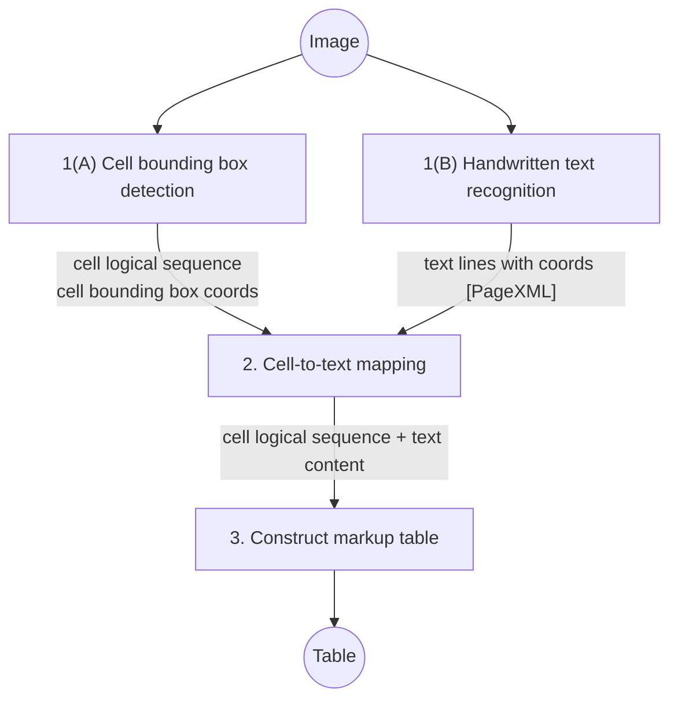

# Handwritten Table to Knowledge Graph Pipeline

A modular, provenance-aware pipeline that turns images of handwritten historical tables into RDF Knowledge Graphs, with **cell-level provenance** for every extracted fact.

The test case is the Dutch colonial military registers (*stamboeken*) held by the Nationaal Archief, inventory `NL-HaNA_2.10.50`.

## Overview

Historical handwritten tables hold rich structured information, but they are hard to use: layouts are irregular, pages are degraded and handwriting varies a lot. This repository combines:

- **Table Structure Recognition (TSR)**: finding the cells and their row/column layout
- **Handwritten Text Recognition (HTR)**: reading the text in each cell
- **Information Extraction (IE)**: LLM-based extraction of person attributes and military postings, guided by a LinkML schema
- **Assertion graph construction**: the extracted facts as RDF (CIDOC-CRM)
- **Provenance graph construction**: links each fact back through *entity → text span → cell → row → table → image* (PROV, CSVW, `dc:isPartOf`), validated with SHACL

Table reconstruction can be done three ways (Transkribus, an ML pipeline, or a vision LLM). The experiments compare them on accuracy and on how well each keeps provenance through the intermediate representations, and on how easily a human can correct the output.



```
Image (.jpg) ─► Table reconstruction ─► PageXML ─► HTML table ─► IE (JSON) ─► RDF (assertion + provenance .trig)
```


## Setup

```bash
git clone --recurse-submodules git@github.com:Shoilee/stamboeken_htr.git
cd stamboeken_htr
# or, if already cloned:
git submodule update --init --recursive

conda env create -f htr_env.yml   # Python 3.11: rdflib, pyshacl, ontogpt, groq, apted, shapely, …
conda activate htr_test
```

Depending on which parts you run, you also need:

| Component | Needed for | Requirement |
|---|---|---|
| Ollama with `llama3` | OntoGPT IE (default model `ollama/llama3`) | A local Ollama server: `ollama pull llama3 && ollama serve` |
| Groq API key | LLM table reconstruction, Groq-based IE | `.env` with `LLM_MODEL` and `GROQ_API_KEY`, and `src/LLM_key.py` / `Image2Table_LLM/LLM_key.py` defining `groq_key` and `llm_model` (all gitignored, never commit them) |
| LORE-TSR env | ML cell detection | Separate Python 3.7 env, see below |
| Docker + Loghi models | ML HTR | See below |

> **Run everything from the repository root.** Paths such as `data/...` are hardcoded at the top of each script and are relative to the working directory. Note that `src/run_scripts.py`, `src/reconstruct_table.py` and `src/LLM.py` use bare imports (`from utils import ...`), so run them with `PYTHONPATH=src`.

Working data (`data/images`, `data/htr`, `data/tables`, `data/json`, `data/triples`, …) is gitignored. Only `data/schema/` and `data/labels/` are under version control.

## Quick start

Put the page images in `data/images/` (named `NL-HaNA_2.10.50_<inventory>_<page>.jpg`). Then:

```bash
# 1. Table reconstruction → PageXML (pick one approach)
python src/run_scripts.py --exp_name transkribus --data_path data --output_path data/tables
# Note that, for transkribus PageXML exported from the Transkribus UI. This step is manual.

# 2–3. PageXML → HTML → IE JSON, with evaluation against data/labels
mkdir -p data/json
python experiment_1.py

# 4. JSON → assertion + provenance graphs in data/triples/
mkdir -p data/triples
python src/constructPersonBasicInfoKG.py          # or src/constructMilitaryPostingEventsKG.py
```

See [`examples/`](examples/) for what each stage's output looks like for one page (`NL-HaNA_2.10.50_45_0143`): the image, PageXML, HTML table, extracted JSON, and predicted vs. ground-truth cells.

## 1. Table reconstruction (TSR + HTR)

All approaches produce PageXML. The dispatcher is:

```bash
python src/run_scripts.py --exp_name {ml,transkribus,llm,llm_multi} --data_path <dir> [--output_path <dir>]
```

### Approach 1: Transkribus

Process the images in the Transkribus UI and export PageXML. This step is manual. 

### Approach 2: ML pipeline (LORE-TSR + Loghi)



#### 1(A) Cell bounding box detection with LORE-TSR

The submodule [`Image2TableBoundingBoxDetection`](Image2TableBoundingBoxDetection/) is a modified [LORE-TSR documentation](https://github.com/AlibabaResearch/AdvancedLiterateMachinery/tree/main/DocumentUnderstanding/LORE-TSR).

```bash
cd Image2TableBoundingBoxDetection
conda create --name Lore python=3.7
conda activate Lore
pip install -r requirements.txt

# Build DCNv2
pip install Cython
cd src/lib/models/networks/DCNv2
chmod +x *.sh
./make.sh
cd ../../../../../
mkdir model
```

Download the pretrained table-cell model [ckpt_wtw](https://drive.google.com/file/d/1n33c9jmGmjSfRbheleE1pqiIXBb_BCEw/view) into `model/`. Set the model architecture, model path and input/output directories in `src/scripts/infer/demo_wired.sh`, then:

```bash
cd src
bash scripts/infer/demo_wired.sh
```

The outputs go to `data/tables/cells/center/` (bounding boxes) and `data/tables/cells/logi/` (logical structure).

For more installation help, see [LORE-TSR documentation](https://github.com/AlibabaResearch/AdvancedLiterateMachinery/tree/main/DocumentUnderstanding/LORE-TSR).

#### 1(B) Handwritten text recognition with Loghi

```bash
docker pull loghi/docker.laypa
docker pull loghi/docker.htr
docker pull loghi/docker.loghi-tooling
```

Download these models from [SURFdrive](https://surfdrive.surf.nl/files/index.php/s/YA8HJuukIUKznSP):
- the Laypa model `general` (baseline detection)
- the Loghi-HTR model `float32-generic-2023-02-15` (text recognition)

Set the model paths in `loghi/scripts/inference-pipeline.sh` (see the [Loghi documentation](https://github.com/knaw-huc/loghi)), then run:

```bash
python src/run_loghi.py        # PageXML per image → data/htr/page/
```

#### 2–3. Merge cells and text into a table

```bash
python src/reconstruct_table.py
```

This maps text lines to cells by polygon overlap and writes the reconstructed table.

### Approach 3: Vision LLM

- **Single prompt**: [`src/LLM.py`](src/LLM.py), run through `--exp_name llm`.
- **Modular / multi-turn conversation**: the [`Image2Table_LLM`](Image2Table_LLM/) submodule:
  ```bash
  cd Image2Table_LLM
  python run_modular_llm.py
  ```
  Then convert the LLM output to PageXML with [`src/llm_pagexml.ipynb`](src/llm_pagexml.ipynb).

## 2. PageXML → HTML

`pagexml_to_html` in [`src/utils.py`](src/utils.py) renders the PageXML as an HTML table. Each `<td>` keeps its `id`, `row`, `col`, `rowspan` and `colspan`, which is what later lets provenance be traced back to the cell.

## 3. Information extraction

The HTML is parsed into logical rows, one per person, with rowspans expanded. Each row is sent to [OntoGPT](https://github.com/monarch-initiative/ontogpt) using a LinkML template from [`data/schema/`](data/schema/), and the extracted text spans are mapped back to cell IDs.

- Default: [`src/person_info_extraction_ontogpt.py`](src/person_info_extraction_ontogpt.py) (OntoGPT, `ollama/llama3`)
- Alternatives: [`src/person_info_extraction.py`](src/person_info_extraction.py) (Groq prompt or regex) and [`src/information_extraction/`](src/information_extraction/) (regex rules)

### Schemas

| File | Purpose |
|---|---|
| [`personbasicinfo.yaml`](data/schema/personbasicinfo.yaml) | Person name, parents, birth date/place, … |
| [`militarypostingevents.yaml`](data/schema/militarypostingevents.yaml) | Military postings: unit, place, time span, rank, note |
| [`data_provenance.ttl`](data/schema/data_provenance.ttl) | SHACL shapes for Table / Row / Cell / span provenance |

The `annotations.prompt` fields in the LinkML templates are the actual instructions given to the LLM, so editing them changes extraction behaviour.

## 4. KG construction

```bash
python src/constructPersonBasicInfoKG.py
python src/constructMilitaryPostingEventsKG.py
```

For each image in `data/images/`, these scripts read `data/json/<image>.json` and `data/tables/pagexml/<image>.xml` and write:

- `data/triples/<image>_assertion.trig`: the extracted facts (CIDOC-CRM)
- `data/triples/<image>_provenance.trig`: entity → span → cell → row → table → image (PROV, CSVW, `dc:isPartOf`)

The provenance graph is validated with pyshacl against `data_provenance.ttl`, and triple counts are printed. The two scripts have the same structure, so a change to one usually needs to be made in the other as well.

## Experiments and evaluation

| Script | What it measures |
|---|---|
| [`experiment_1.py`](experiment_1.py) | For each PageXML in `data/tables/pagexml`: **mAP** (cell polygon IoU, Hungarian matching), **TEDS / TEDS-Struct**, and IE **precision / recall / F1** |
| [`baseline.py`](baseline.py) | The same metrics for the baseline setup |
| [`experiment_1b.py`](experiment_1b.py) | Share of extracted values that carry cell provenance, and IE scores recomputed after dropping values without provenance |
| [`experiment_2.py`](experiment_2.py) | Builds a folio-45 subgraph from the existing Bronbeek KG (`Bronbeek_Data/Stamboeken.trig`), downloads the images, and creates JSON ground truth |

All metrics are implemented in [`src/metrics.py`](src/metrics.py). Ground truth is in [`data/labels/`](data/labels/):

- `polygons/*.polygons.json`: cell geometry
- `tables/*.html`: table structure and text
- `info/`: IE labels

There is no automated test suite. To check a change, run the relevant script on the five folio-45 images in `data/images/`.

## Paper

This repository contains the code and evaluation scripts for the following paper:

> Sarah Binta Alam Shoilee, Victor de Boer, Jacco van Ossenbruggen and Susan Legêne. **From Historical Tabular Image to Knowledge Graphs: A Provenance-Aware Modular Pipeline**. arXiv:2605.08222, 2026. [https://arxiv.org/abs/2605.08222](https://arxiv.org/abs/2605.08222)

A shorter version of this paper has been accepted at the 5th International Conference on Hybrid Human-Artificial Intelligence (HHAI 2026).

The evaluation scripts are listed under [Experiments and evaluation](#experiments-and-evaluation).

## Citation

If you use this code or build on this work, please cite the paper:

```bibtex
@misc{shoilee2026historicaltabularimageknowledge,
  title         = {From Historical Tabular Image to Knowledge Graphs: A Provenance-Aware Modular Pipeline},
  author        = {Sarah Binta Alam Shoilee and Victor de Boer and Jacco van Ossenbruggen and Susan Legêne},
  year          = {2026},
  eprint        = {2605.08222},
  archivePrefix = {arXiv},
  primaryClass  = {cs.CV},
  url           = {https://arxiv.org/abs/2605.08222}
}
```

If you use the ML pipeline, please also cite [LORE-TSR](https://github.com/AlibabaResearch/AdvancedLiterateMachineryDocumentUnderstanding/tree/main/LORE-TSR) and [Loghi](https://github.com/knaw-huc/loghi), following the instructions in their repositories.

## Acknowledgements

<!-- TODO: add funding body, grant number, and any people or institutions to thank. -->

The source images are the Dutch military registers (*stamboeken*) held by the [Nationaal Archief](https://www.nationaalarchief.nl/), inventory `NL-HaNA_2.10.50`.

This work builds on several open tools and projects:

- [LORE-TSR](https://github.com/AlibabaResearch/AdvancedLiterateMachinery/tree/main/DocumentUnderstanding/LORE-TSR) for table cell detection
- [Loghi](https://github.com/knaw-huc/loghi) for handwritten text recognition
- [NGTR](https://github.com/lqzxt/NGTR) (Neighbor-Guided Toolchain Reasoner) for table recognition with vision LLMs
- [Transkribus](https://www.transkribus.org/) as one of the compared table reconstruction approaches
- [OntoGPT](https://github.com/monarch-initiative/ontogpt) and [LinkML](https://linkml.io/) for schema-guided information extraction
- [rdflib](https://rdflib.readthedocs.io/en/) and [pySHACL](https://pypi.org/project/pyshacl/0.9.5/) for graph construction and validation

## License

The code in this repository is released under the [MIT License](LICENSE). It is free to use, modify and share, for research and any other purpose, as long as the copyright notice is kept.

This license does not extend to the paper, the submodules or the archival material:

- The arXiv version of the paper is distributed under [CC BY-NC-SA 4.0](https://creativecommons.org/licenses/by-nc-sa/4.0/).
- [`loghi`](loghi/) is distributed under the MIT License.
- [`Image2TableBoundingBoxDetection`](Image2TableBoundingBoxDetection/) is a modified version of LORE-TSR and is distributed under the Apache License 2.0.
- The register images are held by the Nationaal Archief and are subject to its terms of use.

